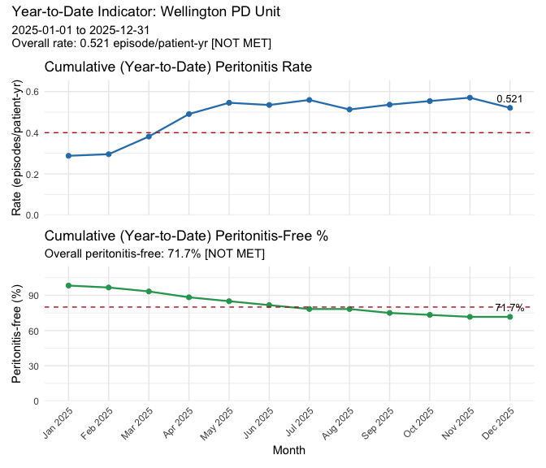

<!-- README.md is generated from README.Rmd. Please edit README.Rmd, then run devtools::build_readme(). -->

# peridial

<!-- badges: start -->

<!-- badges: end -->

**peridial** turns the peritoneal dialysis (PD) records a unit already
keeps into the two peritonitis indicators recommended by the
International Society for Peritoneal Dialysis (ISPD): the **peritonitis
rate** (episodes per patient-year at risk) and the **peritonitis-free
percentage**.

You give it two tables, one row per PD catheter and one row per
peritonitis episode, and a reporting period. peridial:

- **reads** Excel, CSV or data frames, matching column names by keyword
  so small naming differences don’t need fixing by hand;
- **validates** every record and reports *all* problems in one error,
  rather than quietly dropping patients from the denominator;
- **classifies** episodes as relapsing, recurrent or repeat (ISPD 2022),
  so relapses are not double-counted;
- **summarises** the unit against the ISPD benchmarks with `print()`,
  `summary()`, `plot()` and `subset()` methods.

Data are held in four nested S3 classes, `pd_unit` → `pd_patient` →
`pd_catheter` → `pd_infection`, each with a constructor that checks it
is consistent with the level above.

> **Disclaimer:** peridial is a research and quality-improvement tool.
> It has not been validated for clinical decision-making, and its output
> should be checked against your unit’s own records before being
> reported. The bundled example data are synthetic; no real patient data
> are included.

## Installation

peridial is not on CRAN. Install the development version from GitHub:

``` r
# install.packages("remotes")
remotes::install_github("ernestcaballero/peRidial", build_vignettes = TRUE)
```

The repository is called `peRidial`, but the package is loaded in lower
case:

``` r
library(peridial)
```

**Requirements**

- R 4.1.0 or later.
- A C++ compiler, because peridial includes compiled code (via Rcpp) and
  is built from source:
  - **Windows:** install
    [Rtools](https://cran.r-project.org/bin/windows/Rtools/) matching
    your R version.
  - **macOS:** install the Xcode Command Line Tools with
    `xcode-select --install` in Terminal.
  - **Linux:** a compiler is usually already present; otherwise install
    your distribution’s R development tools (for example `r-base-dev` on
    Debian/Ubuntu).
- `plot()` also needs **ggplot2** and **patchwork**, which are suggested
  rather than required:

``` r
install.packages(c("ggplot2", "patchwork"))
```

To build the vignettes locally as well, use
`remotes::install_github("ernestcaballero/peRidial", build_vignettes = TRUE)`.

## Worked example

The package ships two synthetic Excel files for a fictional unit’s 2025
reporting year: `a3_2025.xlsx` (62 catheters across 60 patients) and
`pe_2025.xlsx` (28 peritonitis episodes).

### 1. Build the unit

Point `pd_unit()` at the two files and give the reporting period:

``` r
library(peridial)

unit <- pd_unit(
  unit_data      = system.file("extdata", "a3_2025.xlsx", package = "peridial"),
  infection_data = system.file("extdata", "pe_2025.xlsx", package = "peridial"),
  t0 = as.Date("2025-01-01"),
  t1 = as.Date("2025-12-31"),
  unit_id = "Wellington PD Unit"
)
#> Warning: 1 prevalent patient(s) at t0 (2025-01-01) have their first episode in
#> the infection file within 28 days of t0. Check the previous reporting period
#> for: SPD0012 (2025-01-18). If there was an earlier episode, add its row, with
#> last_dose_antibiotic, to infection_data: episodes before t0 are used only to
#> classify later episodes and are not counted. If there was none, this warning
#> can be ignored.

unit
#> <pd_unit> Wellington PD Unit 
#>   Reporting period      : 2025-01-01 to 2025-12-31
#>   Patients              : 60 (20 incident)
#>   Catheters             : 62
#>   Peritonitis episodes  : 28
#>   Total patient-years   : 48.00
```

The warning is expected. One patient’s first episode falls within 28
days of `t0`, so it may be a relapse of an episode from the previous
year that is not in the file. Including the previous period’s episodes
in `infection_data` resolves it.

### 2. Check the indicators

`summary()` reports both indicators against the ISPD benchmarks (rate ≤
0.40 episodes/patient-year; peritonitis-free \> 80%), along with episode
types, outcomes, and the cohort’s characteristics:

``` r
summary(unit)
#> <summary.pd_unit>  Wellington PD Unit
#> Reporting period   2025-01-01 to 2025-12-31
#> ════════════════════════════════════════════════════════
#> 
#>  PERITONITIS RATE
#>    Rate                            0.521 episodes/patient-year
#>    Countable episodes              25
#>    Patient-years at risk           48.00
#>    ISPD benchmark                  <= 0.40        [ NOT MET ]
#> 
#>  PERITONITIS-FREE (PF)
#>    PF                              71.7%
#>    Patients, zero countable eps    43 of 60
#>    ISPD benchmark                  > 80%          [ NOT MET ]
#> 
#>  EPISODES BY TYPE
#>    recurrent                       4
#>    relapsing                       3
#>    repeat                          2
#>    uncategorised                   19
#> 
#>  COHORT OUTCOMES
#>    death                           3
#>    permanent transfer to HD        6
#>    still active                    48
#>    transplant                      3
#> 
#>  DEMOGRAPHICS
#>    Mean age                        54 (at t1)
#>    Gender                          Female 25, Male 35
#>    Ethnicity                       Asian 8, Maori 16, NZ European 19, Other 1, Pacific Islander 16
#>    Kidney disease                  Diabetic nephropathy 18, Glomerulonephritis 13, Hypertensive nephropathy 10, IgA nephropathy 9, Polycystic kidney disease 5, Reflux nephropathy 5
#>    Diabetes                        None 20, Type 1 3, Type 2 37
#>    Smoking status                  Current 10, Ex-smoker 22, Never 28
#>    Dialysis type                   APD 29, CAPD 31
#> 
#>  CATHETERS
#>    Total                           62
#>    Procedure type                  Laparoscopic 19, Percutaneous 2, Surgical 41
#>    Time to PD start (mean)         14.7 days
#>    Time to 1st peritonitis (mean)  119.7 days
#> 
#>  INFECTIONS
#>    Organisms cultured              E. coli 5, Enterococcus 2, Klebsiella 3, negative 3, P. aeruginosa 3, S. aureus 5, S. epidermidis 7
#>    PE outcome                      hospitalisation 7, none 20, temporary transfer to HD 1
#>    Culture-negative peritonitis    3 (10.7%)
#>    Peritonitis catheter removal    0 (0.0%)
#> 
#>  COHORT
#>    Patients                        60 (20 incident, 40 prevalent)
```

The printed report is a view; `summary()` also invisibly returns the
numbers as a list, so `s <- summary(unit); s$rate` gives the rate for
further use.

### 3. Plot the year

``` r
plot(unit, type = "yearly")
```



Use `type = "monthly"` or `"quarterly"` for a binned rate trend.

### Classifying episodes directly

The episode classifier is also available on its own, for use on plain
vectors. It runs in C++:

``` r
classify_episode_types(
  patient_id           = c("ABC1234", "ABC1234", "XYZ5678", "XYZ5678"),
  infection_date       = as.Date(c("2025-04-01", "2025-05-12", "2025-03-31", "2025-07-13")),
  last_dose_antibiotic = as.Date(c("2025-04-15", "2025-06-01", "2025-04-14", "2025-07-27")),
  organism_list        = list(list("E. coli"), list("E. coli"), list("E. coli"), list("E. coli"))
)
#> [1] NA          "relapsing" NA          "repeat"
```

The second episode of `ABC1234` is a relapse (same organism within 4
weeks of finishing antibiotics); the second of `XYZ5678` is a repeat
(same organism, more than 4 weeks later). A patient’s first episode has
no type.

## Using your own data

Your tables need these columns; capitalisation, spacing and punctuation
are ignored, and close synonyms (`DOB`, `Sex`, `Infection Date`) are
recognised.

| Table | Required columns |
|----|----|
| Unit (one row per catheter) | Patient ID, Insertion Date, PD Start Date, Date of Birth |
| Peritonitis (one row per episode) | Patient ID, Date of Infection, Organism, Last Dose Antibiotic |

Optional columns, such as PD Stop Date, Date of Death and Transplant
Date, affect censoring and patient-years. The full list, accepted value
formats, and a step-by-step example of renaming a registry export are in
`vignette("peridial")`.

## Learn more

- `vignette("peridial")`: start here. Installation, the example data,
  building a unit from your own data, and what to do when the build
  fails.
- `vignette("data-structures")`: what the four classes hold and how
  their constructors keep them consistent.
- `vignette("indicators-classification")`: how the peritonitis rate and
  peritonitis-free percentage are calculated, and how episodes are
  classified.

## Testing

The test suite uses testthat (3rd edition). From a clone of the
repository:

``` r
devtools::test()
```

## Getting help

Please report bugs or request features at
<https://github.com/ernestcaballero/peRidial/issues>. A minimal
reproducible example, ideally using the bundled data, helps a lot.

## References

- Li PK-T, Chow KM, Cho Y, et al. ISPD peritonitis guideline
  recommendations: 2022 update on prevention and treatment. *Peritoneal
  Dialysis International*. 2022;42(2):110–153.
  <https://doi.org/10.1177/08968608221080586>
- Australia and New Zealand Dialysis and Transplant Registry (ANZDATA).
  Data dictionary and Form A3 survey. <https://www.anzdata.org.au>
- New Zealand Peritoneal Dialysis Registry (NZPDR).

## Citation

To cite peridial in publications, run `citation("peridial")`, or use:

> Caballero E (2026). *peridial: Peritonitis Indicators for Peritoneal
> Dialysis Units*. R package version 0.0.0.9000.
> <https://github.com/ernestcaballero/peRidial>

## License

MIT © Ernest Caballero. See [LICENSE.md](LICENSE.md).
